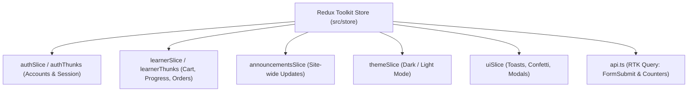

<div align="center">

# 🏛️ TAKXILA AI ACADEMY
### *Next-Gen Interactive Learning Platform & AI Career Accelerator*

[](https://reactjs.org/)
[](https://www.typescriptlang.org/)
[](https://vitejs.dev/)
[](https://mui.com/)
[](https://redux-toolkit.js.org/)
[](https://razorpay.com/)

<p align="center">
  <b>46+ AI Courses</b> • <b>ATS Resume Builder & Scoring</b> • <b>Verifiable Certificates (PDF/PNG)</b> • <b>AI Course Calculator</b><br/>
  <b>Interactive Moodle-Style Gradebook</b> • <b>10 Regional Indian Languages</b> • <b>Data-Driven JSON Architecture</b>
</p>

---

</div>

> [!TIP]
> **Blazing Fast Performance**: Zero-lag typing with concurrent transitions, client-side Blob & Cache API media caching, automated idle code preloading, and a 26% smaller initial bundle powered by dynamic Vite glob routing.

> [!NOTE]
> **Full Client-Side Demo Architecture**: Zero external database dependency required out of the box. State is completely orchestrated with Redux Toolkit and persisted across `localStorage` and `IndexedDB`.

---

## 📑 Table of Contents

- [✨ Highlights & Feature Matrix](#-highlights--feature-matrix)
- [⚡ Quick Start & Run](#-quick-start--run)
- [🗺️ Modular JSON-Driven Routing](#️-modular-json-driven-routing)
- [🎨 Design System & Aesthetic Experience](#-design-system--aesthetic-experience)
- [🧠 Platform Ecosystem & Core Modules](#-platform-ecosystem--core-modules)
  - [1. 🎓 Course Catalog & Udemy-Grade Experience](#1--course-catalog--udemy-grade-experience)
  - [2. 📄 ATS Resume Studio & Keyword Scorer](#2--ats-resume-studio--keyword-scorer)
  - [3. 📜 Verifiable Certificates Engine](#3--verifiable-certificates-engine)
  - [4. 🧮 AI Onboarding Quiz & Course Calculator](#4--ai-onboarding-quiz--course-calculator)
  - [5. 💳 Cart, Combo Offers & Razorpay Payments](#5--cart-combo-offers--razorpay-payments)
  - [6. ✉️ Branded Learner Emails & Mentorship Desk](#6-️-branded-learner-emails--mentorship-desk)
- [💾 Storage & Persistence Architecture](#-storage--persistence-architecture)
- [🏗️ State Management (Redux Toolkit)](#️-state-management-redux-toolkit)
- [🔐 Social Sign-In & Auth Configuration](#-social-sign-in--auth-configuration)
- [🌐 Multilingual Localization (i18n)](#-multilingual-localization-i18n)
- [📁 Project Structure](#-project-structure)
- [🚀 Production Build & Deployment](#-production-build--deployment)

---

## ✨ Highlights & Feature Matrix

| Feature | Technology / Implementation | Highlight |
| :--- | :--- | :--- |
| **Motion Showcase** | Aceternity-inspired FX (spotlight, 3D tilt, flip words) in pure CSS & MUI | Zero animation weight, pure 60fps |
| **Dynamic Routing** | Centralized `routes.json` + Vite `import.meta.glob` | Automated chunking, 26% smaller bundle |
| **ATS Resume Builder** | PDF / DOCX parser (PDF.js legacy + Mammoth) + jsPDF exporter | 5 ATS templates + 0–100 ATS scoring |
| **Certificate Issuer** | Canvas + Template composer (PNG 3072×2048 & PDF) | Cryptographic verification ID (`TXC-...`) |
| **Course Videos** | Auto-generated 10-second summary previews (H.264/VP9) | Native WebM/MP4 adaptive streaming |
| **Payment Gateway** | Razorpay Checkout SDK integration | UPI, Net Banking, Cards & Wallet ready |
| **Notification Center** | Real-time Redux notification bell | Dismissible, linked alerts & announcements |
| **Indian Languages** | 10 Regional languages (`src/data/i18n.ts`) | English, Hindi, Bengali, Tamil, etc. |

---

## ⚡ Quick Start & Run

### Prerequisites
- **Node.js**: v20.0.0 or higher
- **npm**: v10.0.0 or higher

```bash
# 1. Clone repository & install dependencies
npm install

# 2. Launch hot-reloading development server
npm run dev
# ➔ App running at http://localhost:5173

# 3. Typecheck codebase (strict zero-any check)
npm run typecheck

# 4. Generate optimized production bundle
npm run build

# 5. Preview production build locally
npm run preview
# ➔ Serving dist/ at http://localhost:4173
```

---

## 🗺️ Modular JSON-Driven Routing

All routes are fully decoupled from JSX markup and centralized in **[`src/data/routes.json`](file:///c:/Sachin/Takxila/Takxila%20Demo/src/data/routes.json)**.
[`src/App.tsx`](file:///c:/Sachin/Takxila/Takxila%20Demo/src/App.tsx) automatically reads this file, discovers page chunks via Vite's `import.meta.glob`, and generates cached lazy routes on demand.

```json
{
  "public": [
    { "path": "/", "file": "./pages/Landing.tsx" },
    { "path": "/auth", "file": "./pages/AuthPage.tsx" }
  ],
  "redirects": [
    { "path": "/login", "to": "/auth" },
    { "path": "/register", "to": "/auth#register" }
  ],
  "protected": [
    { "path": "home", "file": "./pages/Home.tsx" },
    { "path": "courses", "file": "./pages/Courses.tsx" },
    { "path": "courses/:id", "file": "./pages/CourseDetail.tsx" },
    { "path": "courses/:id/grades", "file": "./pages/CourseDetail.tsx", "props": { "tab": "grades" } },
    { "path": "about", "file": "./pages/Info.tsx", "export": "About" }
  ]
}
```

```tsx
// src/App.tsx
const modules = import.meta.glob<Record<string, ComponentType<any>>>('./pages/**/*.tsx');

export const preloadPages = () => {
  Object.values(modules).forEach((load) => void load());
};
```

---

## 🎨 Design System & Aesthetic Experience

| Element | Dark Mode Palette | Light Mode Palette |
| :--- | :--- | :--- |
| **Primary Base** | Deep Midnight Navy (`#0B1636` → `#13215E`) | Crisp Alabaster & Pure White |
| **Accent / Radiant** | Royal Imperial Gold (`#F5B93F`) | Deep Royal Indigo (`#4338CA`) |
| **Secondary High** | Electric Lavender (`#7C8CFF`) | Soft Mauve / Pastel Violet |
| **Scrollbar Glow** | Polished Gold Custom Track | Elegant Indigo Custom Track |

- **Aceternity UI Effects (`src/components/fx.tsx`)**: Spotlight beam, moving-border buttons, meteors, glowing lamps, flip words, and 3D card tilt — all handcrafted using Material UI's `sx` styling and CSS keyframes without third-party runtime bloat.
- **FastField Transitions**: Inputs decouple state rendering using React Transitions (`useTransition`) for instantaneous, stutter-free typing on heavy forms.

---

## 🧠 Platform Ecosystem & Core Modules

### 1. 🎓 Course Catalog & Udemy-Grade Experience
- **46 Curated Courses** spanning Generative AI, AI Agents, Claude Code, No-Code Workflows, and AI Filmmaking.
- **3 Dynamic Views**: Interactive Category Bubbles, Grid Cards with Pagination, and Compact List View.
- **Udemy-Style Course Detail**: Sticky purchase bar, curriculum accordion, lecture runtime breakdown, preview videos, and student review metrics.

### 2. 📄 ATS Resume Studio & Keyword Scorer
- **Upload & Parser Engine**: Reads uploaded `.pdf` (via bundled legacy PDF.js worker) and `.docx` (via Mammoth + direct XML fallback).
- **Interactive Builder**: 5 ATS-compliant professional themes (Classic, Modern, Professional, Minimal, Executive) with live A4 preview.
- **ATS Keyword Analyzer (`src/features/resume/ats.ts`)**: Scores resumes 0–100, checking for section completeness, impact metrics, action verbs, and job description keyword matches directly in-browser.

### 3. 📜 Verifiable Certificates Engine
- **Automated Issuance**: Automatically triggers upon 100% course lecture completion.
- **Dual Export**: Generates high-res PNG (3072×2048) or single-page formatted PDF.
- **Instant Verification**: On-site certificate verify box validates against the unique verification ID (`TXC-XXXXX`).

### 4. 🧮 AI Onboarding Quiz & Course Calculator
- **11-Question Skill Diagnostic**: Assesses role, experience level, tools of interest, and budget.
- **Smart Recommendation Engine (`src/data/recommend.ts`)**: Computes weighted course matches and custom tailored curricula.
- **Dynamic Pricing Calculator**: Instant bundle pricing adjustments based on selected learning paths.

### 5. 💳 Cart, Combo Offers & Razorpay Payments
- **Smart Combo Engine**: 30% automatic discount on curated multi-course packs, 25% off 4+ custom picks, and ₹4,999 All-Access lifetime pass.
- **Razorpay Checkout Integration**: Configurable test/live modes for seamless UPI, credit/debit cards, and net banking transactions.

### 6. ✉️ Branded Learner Emails & Mentorship Desk
- **Automated HTML Email Triggers**: Purchase receipts, Enrollment confirmations, and Graduation celebrations.
- **EmailJS / FormSubmit Support**: Zero-backend serverless dispatch with fallback to native `mailto:` links.
- **1-on-1 Mentorship Booking**: Schedule sessions with industry mentors or initiate live WhatsApp chats.

---

## 💾 Storage & Persistence Architecture

Every persistence key is isolated and namespaced with `tx_`:

```
┌───────────────────────────────────────────────────────────────┐
│                      BROWSER STORAGE MAP                      │
├───────────────────┬───────────────────┬───────────────────────┤
│    STORAGE TYPE   │      KEY NAME     │      DATA STORED      │
├───────────────────┼───────────────────┼───────────────────────┤
│ localStorage      │ tx_users          │ Registered accounts   │
│ localStorage      │ tx_session        │ Active auth session   │
│ localStorage      │ tx_theme          │ "dark" | "light"      │
│ localStorage      │ tx_user_<email>   │ User courses & state  │
│ localStorage      │ tx_referrals      │ Referral rewards/code │
│ localStorage      │ tx_announcements  │ Posts & replies       │
│ IndexedDB         │ tx_files          │ Private files (50 MB) │
│ Cache API         │ tx-media-v2       │ Pre-decoded media     │
└───────────────────┴───────────────────┴───────────────────────┘
```

> [!WARNING]
> **Production Notice**: All client-side data is stored in the browser (with SHA-256 password hashing). For production deployment with financial transactions, connect `store/api.ts` to your secure backend API.

---

## 🏗️ State Management (Redux Toolkit)

The entire global state is orchestrated by a single cohesive Redux store (`src/store/`):



---

## 🔐 Social Sign-In & Auth Configuration

Copy `.env.example` to `.env` in the root folder and provide your provider credentials:

```ini
# Social Authentication
VITE_GOOGLE_CLIENT_ID=your-google-oauth-client-id.apps.googleusercontent.com
VITE_FACEBOOK_APP_ID=your-facebook-app-id
VITE_MICROSOFT_CLIENT_ID=your-azure-application-client-id

# Payment Gateway
VITE_RAZORPAY_KEY_ID=rzp_test_your_key_id

# EmailJS Services
VITE_EMAILJS_SERVICE_ID=your_emailjs_service_id
VITE_EMAILJS_TEMPLATE_ID=your_emailjs_template_id
VITE_EMAILJS_PUBLIC_KEY=your_emailjs_public_key
VITE_SITE_URL=https://takxila.in
```

Add the following OAuth redirect URI to your Google, Facebook, and Microsoft dev consoles:
```text
https://YOUR-DOMAIN/oauth-callback.html
```

---

## 🌐 Multilingual Localization (i18n)

The academy navigation and user interface support 10 regional Indian languages:

| Language | Script Code | Example (Courses) |
| :--- | :---: | :--- |
| **English** | `en` | Courses |
| **Hindi (हिंदी)** | `hi` | कोर्सेस |
| **Bengali (বাংলা)** | `bn` | কোর্স |
| **Marathi (मराठी)** | `mr` | कोर्सेस |
| **Gujarati (ગુજરાતી)** | `gu` | અભ્યાસક્રમો |
| **Tamil (தமிழ்)** | `ta` | படிப்புகள் |
| **Telugu (తెలుగు)** | `te` | కోర్సులు |
| **Kannada (ಕನ್ನಡ)** | `kn` | ಕೋರ್ಸ್‌ಗಳು |
| **Malayalam (മലയാളം)** | `ml` | കോഴ്സുകൾ |
| **Punjabi (ਪੰਜਾਬੀ)** | `pa` | ਕੋਰਸ |

---

## 📁 Project Structure

```text
takxila-react/
├── public/                 # Static assets, covers, logo marks, video streams
│   ├── assets/             # WebP covers, certificates, branding logos
│   └── oauth-callback.html # Social auth receiver page
├── src/
│   ├── components/         # Reusable UI widgets, Layout, fast fields, navbar
│   ├── context/            # React context wrappers over Redux hooks
│   ├── data/               # Course catalog, curriculum, quiz data, routes.json
│   │   ├── routes.json     # 🗺️ Master JSON route configuration
│   │   ├── courses.ts      # 46 Course definitions & pricing
│   │   └── courseContent.ts# Detailed lectures, curriculum & modules
│   ├── features/           # Standalone domain features (Resume, Certificate)
│   ├── pages/              # Code-split application route views
│   │   └── account/        # Account views (Grades, Purchases, Calendar, etc.)
│   ├── store/              # Redux slices, thunks, RTK Query endpoints
│   ├── theme/              # Custom MUI typography, scrollbars, colors
│   ├── utils/              # Media cache, storage helpers, Razorpay, mailers
│   ├── App.tsx             # ⚡ Lightweight dynamic glob route engine
│   └── main.tsx            # Root bootstrap, providers & idle preloader
└── package.json            # Dependencies and scripts
```

---

## 🚀 Production Build & Deployment

Because this is a Single Page Application (SPA) using HTML5 `pushState` routing, ensure your server or CDN rewrites all incoming routes to `/index.html`:

- **Netlify**: Handled automatically via `public/_redirects`.
- **Vercel**: Handled automatically via `vercel.json` rewrites.
- **Nginx**:
  ```nginx
  location / {
      try_files $uri $uri/ /index.html;
  }
  ```

---

<div align="center">
  <sub>Built with ❤️ by the Takxila Engineering Team • Dedicated to empowering the next generation of AI innovators.</sub>
</div>
