<div align="center">


# 🏛️ TAKXILA AI ACADEMY
### *Next-Gen Interactive Learning Platform & AI Career Accelerator*

[](https://react.dev/)
[](https://www.typescriptlang.org/)
[](https://vitejs.dev/)
[](https://mui.com/)
[](https://redux-toolkit.js.org/)
[](https://razorpay.com/)
[](#-18-languages--whole-site-translation)

<p align="center">
  <b>46 AI Courses</b> • <b>Moodle Academy Cart & Checkout</b> • <b>Google / Facebook / Microsoft Login</b> • <b>18 Languages</b><br/>
  <b>ATS Resume Builder & Scoring</b> • <b>Certificates (PDF/PNG)</b> • <b>Branded Emails</b> • <b>AI Course Calculator</b> • <b>JSON-Driven Config</b>
</p>


---

</div>

> [!TIP]
> **Blazing fast**: zero-lag typing with concurrent transitions, Blob and Cache API media caching, idle-time page preloading, and code split per route through `import.meta.glob`.

> [!NOTE]
> **Works with no backend out of the box.** All state lives in Redux Toolkit and is saved to `localStorage` and `IndexedDB`. Payments, emails, social login and the academy cart plug in through `.env` and the JSON files in `src/data/`.

> [!IMPORTANT]
> **Never put a client secret in this project.** Everything in a website is sent to the browser and is public. Only the public client IDs belong in `.env` or `src/data/oauth.json`. A secret-based token exchange needs a small backend (see [Social login](#-social-login-google--facebook--microsoft)).

---

## 📑 Table of Contents

- [🆕 What's New](#-whats-new)
- [📸 Screenshots](#-screenshots)
- [✨ Feature Matrix](#-feature-matrix)
- [⚡ Quick Start](#-quick-start)
- [⚙️ Configuration (`.env` and JSON files)](#️-configuration-env-and-json-files)
- [🧠 Core Modules](#-core-modules)
  - [1. 🎓 Course Catalog & Course Pages](#1--course-catalog--course-pages)
  - [2. 🏷️ Special-Offer Promo Cards](#2-️-special-offer-promo-cards)
  - [3. 🛒 Cart, Combo Offers, Academy Checkout & Razorpay](#3--cart-combo-offers-academy-checkout--razorpay)
  - [4. 📄 ATS Resume Studio](#4--ats-resume-studio)
  - [5. 📜 Certificates](#5--certificates)
  - [6. ✉️ Branded Learner Emails](#6-️-branded-learner-emails)
  - [7. 🧮 AI Quiz & Course Calculator](#7--ai-quiz--course-calculator)
  - [8. 🔔 Notifications & Announcements](#8--notifications--announcements)
- [🌐 18 Languages & Whole-Site Translation](#-18-languages--whole-site-translation)
- [🔐 Social Login (Google · Facebook · Microsoft)](#-social-login-google--facebook--microsoft)
- [🏫 Takxila Academy (Moodle) Integration](#-takxila-academy-moodle-integration)
- [🏗️ State Management (Redux Toolkit)](#️-state-management-redux-toolkit)
- [🗺️ JSON-Driven Routing](#️-json-driven-routing)
- [💾 Storage & Persistence](#-storage--persistence)
- [📁 File Management: Every Folder Explained](#-file-management-every-folder-explained)
- [✍️ Common Tasks (How do I…?)](#️-common-tasks-how-do-i)
- [🎨 Design System](#-design-system)
- [🚀 Production Build & Deployment](#-production-build--deployment)
- [🧯 Troubleshooting](#-troubleshooting)

---

## 🆕 What's New

| Version | Highlights |
| :--- | :--- |
| **new-code-5** | Course content from the Word files for 17 more courses: Lovable, ChatGPT, Claude (4 courses), Gemini, Perplexity, DeepSeek, Generative AI, Midjourney (2), Kling (2), Google Omni (2) and Canva. Prices and titles unchanged |
| **new-code-4** | Course content from the Word files for 9 courses (sections, lectures, includes, level, language) · black-and-gold **special-offer promo card** on course pages and Home · **8 more languages** (18 total) with **whole-site live translation** · **Google, Facebook and Microsoft login** through Redux · **Academy cart sync** on every add-to-cart, plus **Proceed to checkout** on academy.takxila.in · this README |
| **new-code-3** | Reliable PDF and DOCX reading for the ATS score · branded HTML emails with the logo for purchase, free enrolment and course completion · About Us page |
| **new-code-2** | Certificate on your own template (PNG + PDF) · resume builder with 5 ATS themes and a clean PDF · ATS score · Redux everywhere · dismissible notifications · faster pages and smooth typing |

---

## 📸 Screenshots

<table>
  <tr>
    <td width="50%"><b>Landing</b><br/>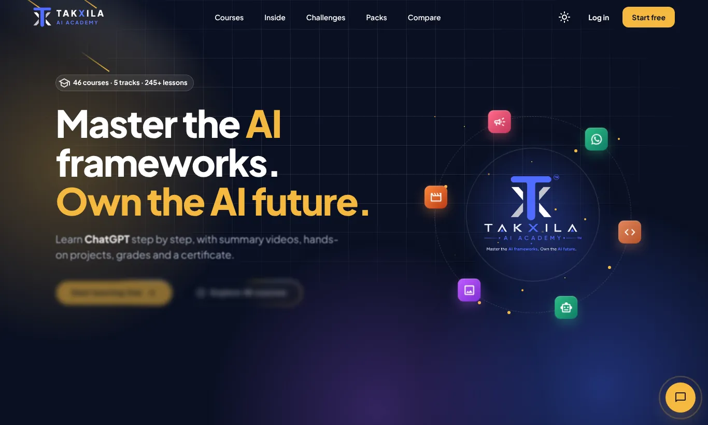</td>
    <td width="50%"><b>Login & social sign-in</b><br/></td>
  </tr>
  <tr>
    <td><b>Special offers on Home</b><br/>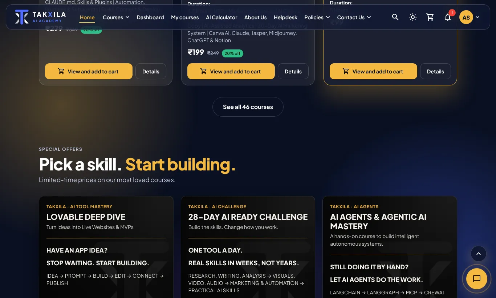</td>
    <td><b>Promo card on a course page</b><br/>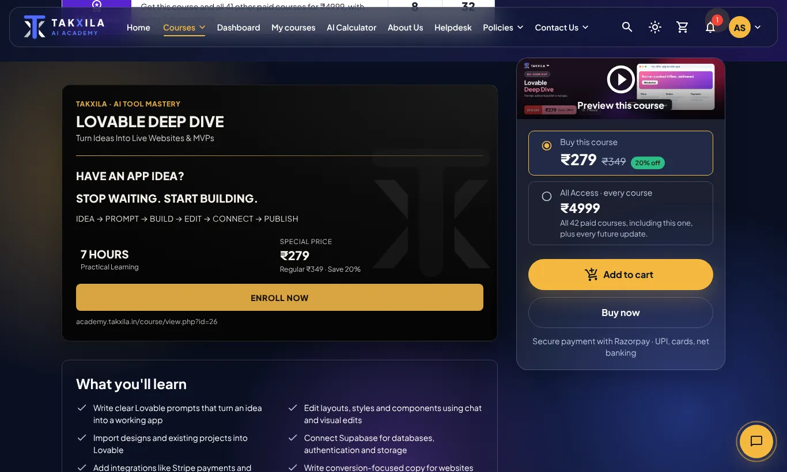</td>
  </tr>
  <tr>
    <td><b>Course catalog</b><br/>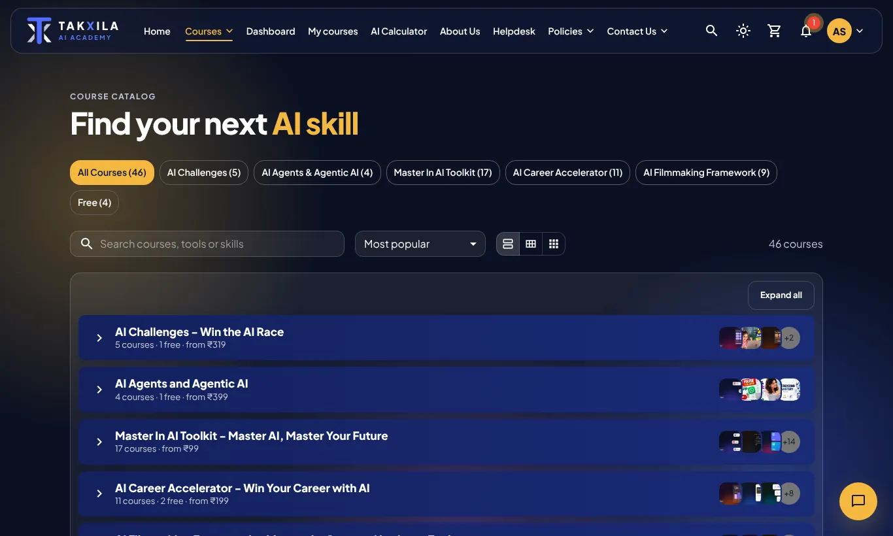</td>
    <td><b>Course detail (content from Word files)</b><br/>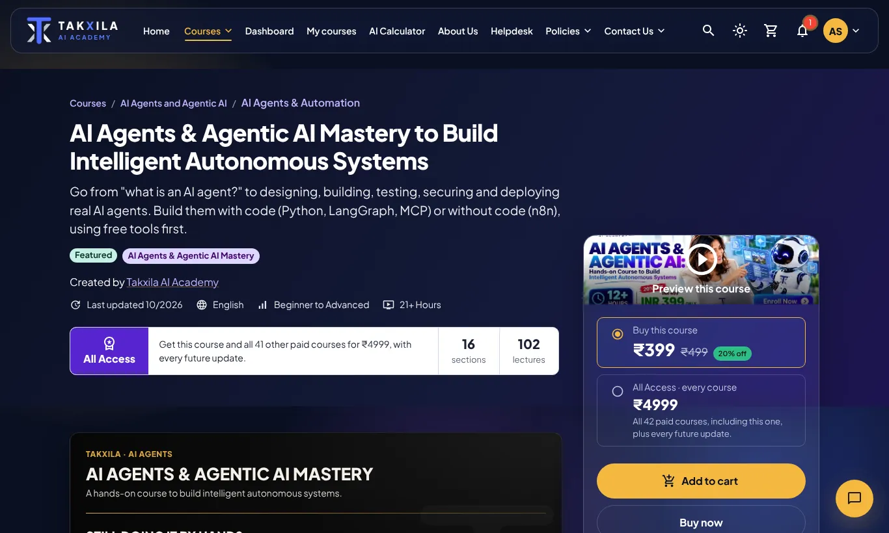</td>
  </tr>
  <tr>
    <td><b>Cart</b><br/>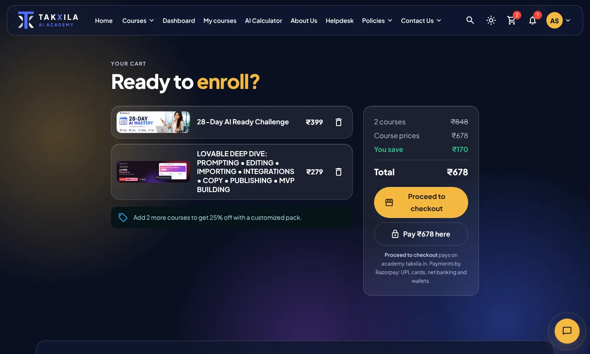</td>
    <td><b>Checkout on Takxila Academy</b><br/>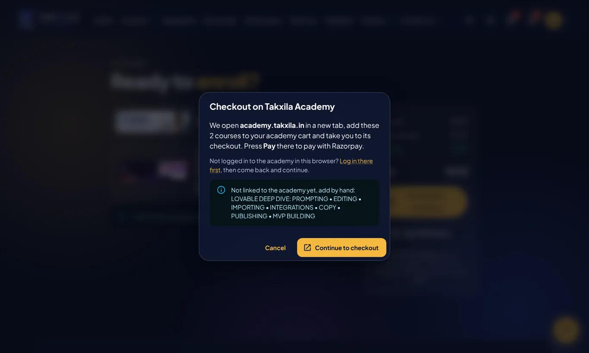</td>
  </tr>
  <tr>
    <td><b>Dashboard</b><br/>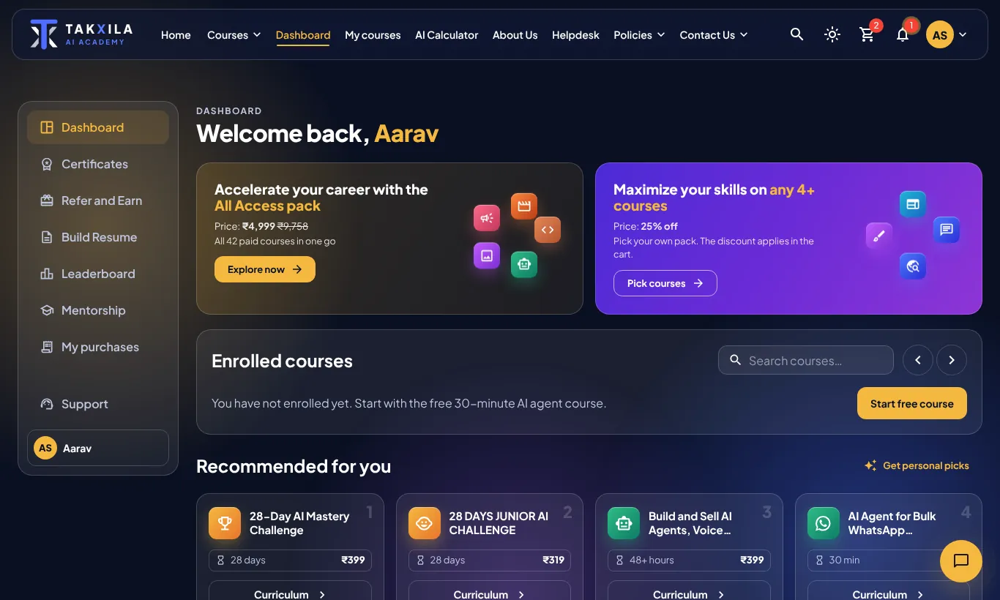</td>
    <td><b>Resume builder & ATS themes</b><br/>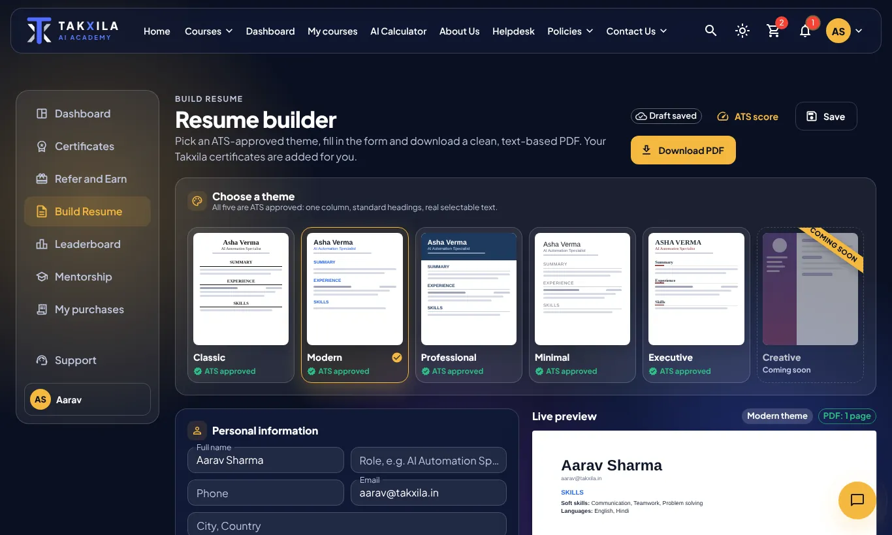</td>
  </tr>
  <tr>
    <td><b>Certificates</b><br/>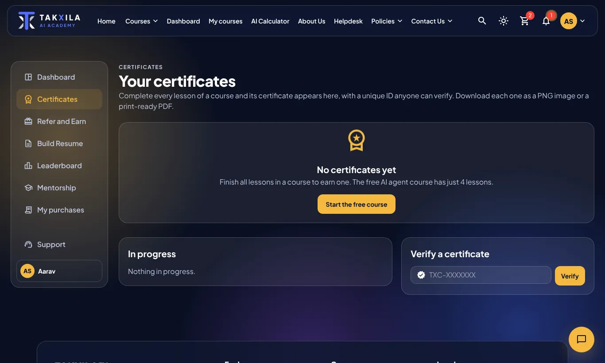</td>
    <td><b>18 languages</b><br/>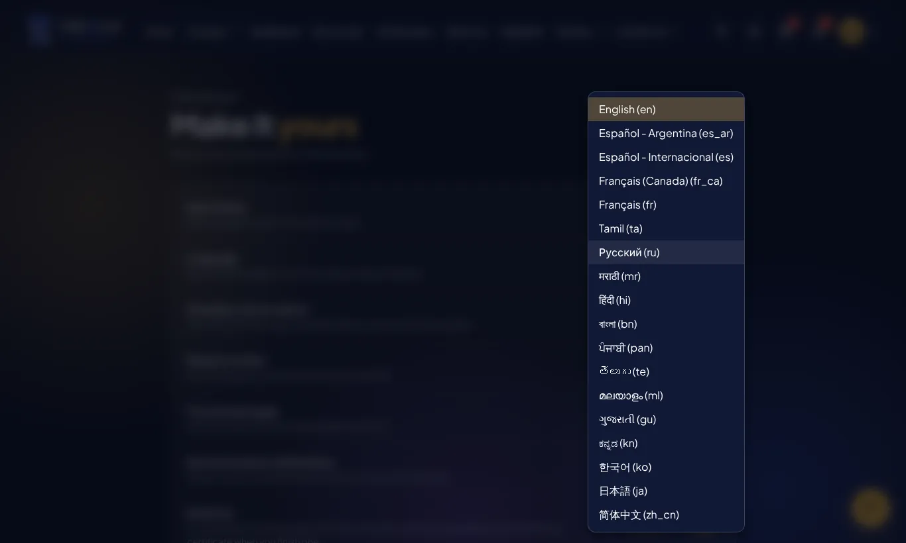</td>
  </tr>
  <tr>
    <td><b>AI course calculator</b><br/></td>
    <td><b>Mentorship</b><br/>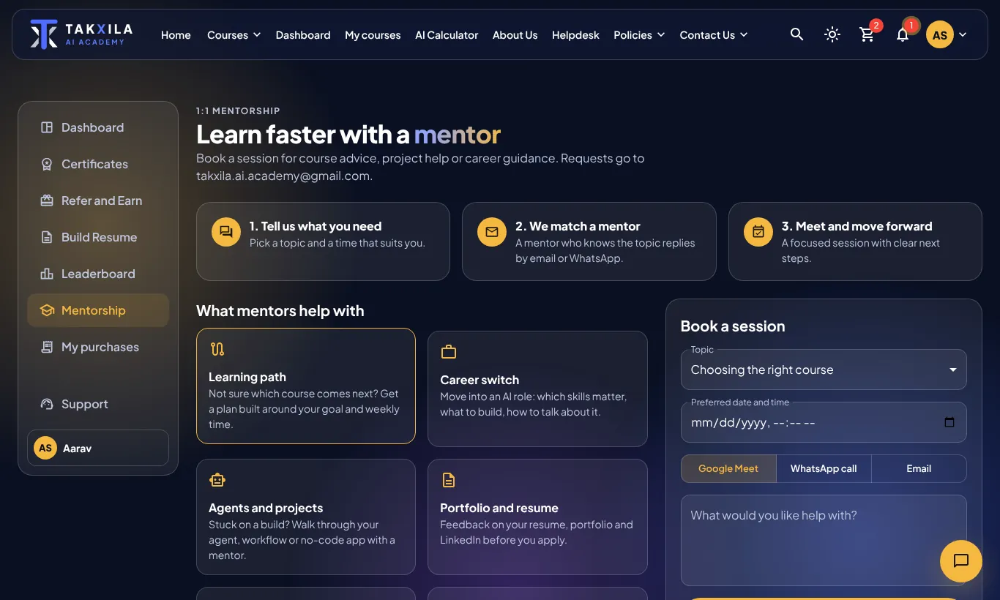</td>
  </tr>
  <tr>
    <td><b>About Us</b><br/>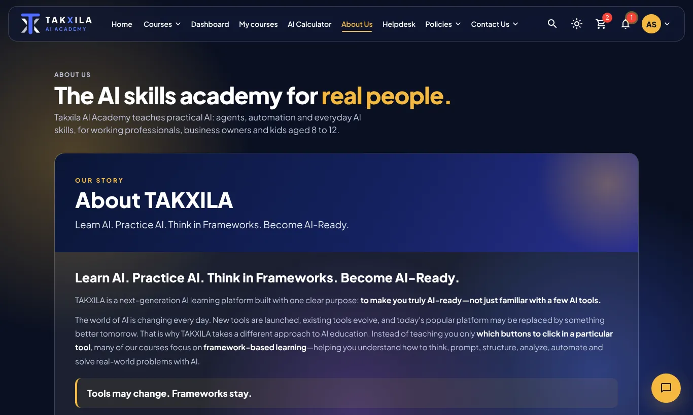</td>
    <td align="center"><b>Mobile (390 px)</b><br/></td>
  </tr>
</table>

> Screenshots live in [`docs/screenshots/`](docs/screenshots). They are WebP files so the zip stays small.

---

## ✨ Feature Matrix

| Feature | Implementation | Where |
| :--- | :--- | :--- |
| **Course catalog** | 46 courses, category bubbles, grid and list views, search | `src/data/courses.ts`, `src/pages/Courses.tsx` |
| **Course content** | Sections, lectures and durations; 9 courses from your Word files | `src/data/courseContent.ts` |
| **Promo cards** | Black-and-gold card per course, text from JSON | `src/components/CoursePromo.tsx`, `src/data/promos.json` |
| **Academy cart** | Background add to the Moodle cart + guided checkout | `src/utils/academy.ts`, `src/data/academy.json` |
| **Razorpay** | Checkout SDK, test and live keys | `src/utils/razorpay.ts` |
| **Social login** | Google, Facebook, Microsoft popup sign-in via Redux thunk | `src/utils/social.ts`, `src/data/oauth.json` |
| **Languages** | 18 languages; menus from our dictionary, the rest by live translation | `src/data/i18n*.ts`, `src/utils/siteTranslate.ts` |
| **ATS resume** | 5 themes + "coming soon", jsPDF export, 0–100 score from PDF/DOCX/TXT | `src/features/resume/` |
| **Certificates** | Your template, PNG 3072×2048 and one-page PDF, verify by ID | `src/features/certificate/` |
| **Emails** | Branded HTML with logo; EmailJS or FormSubmit | `src/emails/` |
| **Notifications** | Bell with dismiss (X) per item | `src/components/NotificationBell.tsx` |
| **State** | Redux Toolkit slices, thunks and RTK Query | `src/store/` |
| **Routing** | `routes.json` + `import.meta.glob` lazy pages | `src/App.tsx`, `src/data/routes.json` |

---

## ⚡ Quick Start

**Needs** Node.js 20+ and npm 10+.

```bash
npm ci                 # install exact dependency versions from package-lock.json
cp .env.example .env   # optional: Razorpay key, EmailJS, site URL
npm run dev            # http://localhost:5173
npm run typecheck      # strict TypeScript check
npm run build          # production build in dist/
npm run preview        # serve dist/ at http://localhost:4173
```

> [!TIP]
> On Windows PowerShell use `copy .env.example .env` instead of `cp`.

---

## ⚙️ Configuration (`.env` and JSON files)

Most things you will want to change are **data, not code**. Edit the file, save, and `npm run dev` reloads.

| What | File | Notes |
| :--- | :--- | :--- |
| Razorpay key, EmailJS, site URL | `.env` | Copy from `.env.example`. Only `VITE_*` values reach the site. |
| Social login client IDs | `src/data/oauth.json` (or `.env`) | Public IDs only. `.env` wins if both are set. |
| Login button labels | `src/data/authExtras.json` | Also calendar weekdays and the visitor counter. |
| Academy URLs and course instances | `src/data/academy.json` | See [Academy integration](#-takxila-academy-moodle-integration). |
| Promo card text | `src/data/promos.json` | Per category and per course. |
| Routes and pages | `src/data/routes.json` | Add a page without touching `App.tsx`. |
| Courses, prices, images | `src/data/courses.ts` | Title, price, `was` price, category, hours, image. |
| Course sections & lectures | `src/data/courseContent.ts` | One entry per course id. |
| Combo packs & discounts | `src/data/showcase.ts` | Packs, 25% custom pack, ₹4,999 All Access. |
| Menu translations | `src/data/i18n.ts`, `src/data/i18n.more.ts` | 40 menu keys × 18 languages. |
| About Us content | `src/data/about.tsx` | |

`.env` reference:

```ini
# Public sign-in client IDs (already set in src/data/oauth.json). Never a secret here.
VITE_GOOGLE_CLIENT_ID=125782148071-8mkq9p4g7cu9sbdq788ts2f5npogcnnc.apps.googleusercontent.com
VITE_FACEBOOK_APP_ID=2088492579209696
VITE_MICROSOFT_CLIENT_ID=8f014a78-4fc3-468f-b20e-d678378c1a5a

# Razorpay key id (rzp_test_... while testing, rzp_live_... in production)
VITE_RAZORPAY_KEY_ID=

# Learner emails through EmailJS
VITE_EMAILJS_SERVICE_ID=
VITE_EMAILJS_TEMPLATE_ID=
VITE_EMAILJS_PUBLIC_KEY=

# Your live address, used for the logo and buttons inside emails
VITE_SITE_URL=https://takxila.in
```

---

## 🧠 Core Modules

### 1. 🎓 Course Catalog & Course Pages
- **46 courses** across AI Challenges, AI Agents, Master in AI Toolkit, AI Career Accelerator, AI Filmmaking and free courses.
- **Course page**: sticky buy box (single course or All Access), preview video, "What you'll learn", **"This course includes"**, level and language, curriculum accordion with lecture durations, and a Moodle-style grade view at `/courses/:id/grades`.
- **Content from your Word files** for 9 courses:

| Course id | Sections | Lectures |
| :--- | ---: | ---: |
| `wa-agent` | 4 | 9 |
| `agentic` | 16 | 102 |
| `wa-mastery` | 16 | 85 |
| `n8n-agents` | 13 | 74 |
| `claude-7` | 8 | 47 |
| `mastery-14` | 15 | 105 |
| `junior` | 9 | 35 |
| `mastery-28` | 30 | 146 |
| `ready` | 28 | 106 |

All other courses keep their existing content, prices and titles.

### 2. 🏷️ Special-Offer Promo Cards
A black card with gold accents, modelled on the Lovable Deep Dive poster: category line, title, subtitle, a two-line hook, the workflow (`IDEA → PROMPT → BUILD → …`), hours, special price with savings, and **ENROLL NOW**.

- Shown on every course page the learner does not own yet, and as a **"SPECIAL OFFERS"** row of three on Home.
- Text comes from `src/data/promos.json`: `byCourse.<id>` for a custom card, otherwise `byCategory.<category>`.

```json
"byCourse": {
  "lovable": {
    "label": "AI TOOL MASTERY",
    "title": "LOVABLE DEEP DIVE",
    "sub": "Turn Ideas Into Live Websites & MVPs",
    "hook": ["HAVE AN APP IDEA?", "STOP WAITING. START BUILDING."],
    "flow": ["IDEA", "PROMPT", "BUILD", "EDIT", "CONNECT", "PUBLISH"]
  }
}
```

### 3. 🛒 Cart, Combo Offers, Academy Checkout & Razorpay
- **Combo engine**: 30% off curated packs, 25% off 4+ custom picks, ₹4,999 All Access. The cart nudges the learner toward the nearest pack.
- **Add to cart** also adds the course to the learner's academy cart in the background (when the course is linked in `academy.json`).
- **Proceed to checkout** opens academy.takxila.in, adds every linked course and lands on the academy checkout, where the learner presses **Pay** (Razorpay on the academy).
- **Pay ₹X here** keeps the on-site Razorpay checkout, using `VITE_RAZORPAY_KEY_ID`. Without a key the site offers a demo enrolment.

### 4. 📄 ATS Resume Studio
- 5 ATS-friendly themes (Classic, Modern, Professional, Minimal, Executive) plus a "Coming soon" sixth.
- Live A4 preview and a text-based PDF with no blank pages.
- **ATS score 0–100** for an uploaded `.pdf`, `.docx` or `.txt` (pdf.js legacy build, Mammoth with a JSZip fallback). Old `.doc` files get a clear "save as DOCX" message.

### 5. 📜 Certificates
- Issued automatically when every lesson of a course is complete.
- Rendered on your template (`public/assets/certificate/template.webp`), downloadable as **PNG (3072×2048)** or **PDF**.
- Each certificate has an ID (`TXC-…`) that anyone can check in the verify box.

### 6. ✉️ Branded Learner Emails
- HTML emails with the Takxila logo for **course purchase**, **free enrolment** and **course completion** (greeting plus "your certificate is ready").
- Sent through **EmailJS** when its three keys are set, otherwise through **FormSubmit** with the learner in copy.
- EmailJS template variables: `to_email`, `to_name`, `subject`, `html_body`, `text_body`, `reply_to`. In the EmailJS template, put `{{{html_body}}}` (three braces) as the content.

### 7. 🧮 AI Quiz & Course Calculator
An onboarding quiz about role, experience, tools and budget, a weighted recommendation engine (`src/data/recommend.ts`) and a calculator that prices the suggested learning path.

### 8. 🔔 Notifications & Announcements
A notification bell with an **X** on each item, plus site-wide announcements with replies.

---

## 🌐 18 Languages & Whole-Site Translation

| | | | |
| :--- | :--- | :--- | :--- |
| English (en) | Español - Argentina (es_ar) | Español - Internacional (es) | Français (Canada) (fr_ca) |
| Français (fr) | Tamil (ta) | Русский (ru) | मराठी (mr) |
| हिंदी (hi) | বাংলা (bn) | ਪੰਜਾਬੀ (pan) | తెలుగు (te) |
| മലയാളം (ml) | ગુજરાતી (gu) | ಕನ್ನಡ (kn) | 한국어 (ko) |
| 日本語 (ja) | 简体中文 (zh_cn) | | |

**How it works**
1. **Menus and navigation** use our own dictionary (`src/data/i18n.ts` for the original 10 languages, `src/data/i18n.more.ts` for the 8 new ones), so they switch instantly and offline.
2. **Everything else** (page text, course content, buttons, footer) is translated live by Google's free website translator. `src/utils/siteTranslate.ts` loads it on demand, sets the `googtrans` cookie and the page `lang`, hides Google's banner, and guards the DOM so React keeps working on translated pages.
3. Choosing **English** again removes the translation and reloads the page.
4. The choice is saved per learner (Preferences) and in `tx_lang` for visitors.

> [!NOTE]
> Live translation needs the visitor's browser to reach `translate.google.com`. Brand names and course titles may be translated too; mark any element with `class="notranslate"` to keep it in English.

---

## 🔐 Social Login (Google · Facebook · Microsoft)

The login page has **Login with Gmail**, **Facebook** and **Microsoft** buttons. Each opens the provider in a popup; the provider sends the learner back to `public/oauth-callback.html`, which hands the result to the site. The Redux thunk `signInWithProvider` (in `src/store/authThunks.ts`) tracks the busy button and shows any error.

**Public client IDs** live in `src/data/oauth.json` (and `.env` can override them). **Client secrets are not used and must never be added**: the popup uses the browser-safe flow that needs only the public ID.

### Register the redirect address (required, once per provider)

Use your live domain, plus `http://localhost:5173` for local testing:

```text
https://YOUR-DOMAIN/oauth-callback.html
http://localhost:5173/oauth-callback.html
```

| Provider | Where | What to set |
| :--- | :--- | :--- |
| **Google** | Google Cloud Console → APIs & Services → Credentials → your OAuth client (Web) | **Authorized JavaScript origins**: `https://YOUR-DOMAIN`. **Authorized redirect URIs**: the address above. |
| **Facebook** | developers.facebook.com → your app → Facebook Login → Settings | **Valid OAuth Redirect URIs**: the address above. Add your domain under App Domains. Switch the app to Live. |
| **Microsoft** | Azure Portal → App registrations → your app → Authentication | Add a **Single-page application** (or Web) platform with the address above and tick **ID tokens**. Supported accounts: personal + work. |

Until this is done the provider shows `redirect_uri_mismatch` (Google) or a similar error.

### Why there is no client secret

A client secret proves "this request comes from our server". A website runs on the visitor's computer, so anything in it can be read by anyone. If you later want refresh tokens or server-verified sessions, add a small backend endpoint (for example `/api/auth/callback`) that holds the secret, exchanges the code for tokens, and returns your own session. The frontend then calls that endpoint instead of reading the token itself.

---

## 🏫 Takxila Academy (Moodle) Integration

The site is linked to **academy.takxila.in** (Moodle with the `enrol_cart` plugin). All addresses are in `src/data/academy.json`:

```json
{
  "baseUrl": "https://academy.takxila.in",
  "paths": {
    "addToCart": "/enrol/cart/do.php?action=add&instance={instance}",
    "cart": "/enrol/cart/view.php",
    "checkout": "/enrol/cart/checkout.php",
    "course": "/course/view.php?id={courseId}",
    "search": "/course/search.php?search={query}"
  },
  "syncOnAdd": true,
  "courses": {
    "ready":   { "courseId": null, "instance": 84 },
    "lovable": { "courseId": 26,   "instance": null }
  }
}
```

### Link a course (fill in its instance)
1. On the academy, open the course's enrolment page and click **Add to cart**.
2. In the browser's address bar (or DevTools → Network) you will see `do.php?action=add&instance=NN`.
3. Put `NN` as `instance` for that course id in `academy.json`. Optionally add `courseId` from `course/view.php?id=…`.

Courses with no instance still work on this site; the checkout dialog lists them as "add by hand".

### What happens, step by step

| Step | This site | Academy |
| :--- | :--- | :--- |
| Add to cart | Saves the course in our cart and sends `do.php?action=add&instance=…` in the background | Adds it to the cart **if the learner is logged in to the academy in this browser** |
| Proceed to checkout | Opens a tab that goes through each add link, then `checkout.php` | Shows the cart summary |
| Pay | | The learner presses **Pay** on the academy page (Razorpay) |

> [!IMPORTANT]
> **Pay must happen on the academy page.** The academy's Pay form carries a `sesskey`, a per-login security token that only the academy page knows. Another website cannot read it or submit the form. This is Moodle's protection against fake payments, so it is the right place to pay.
>
> The background add is "fire and forget": the browser does not let our site read the academy's reply. For a confirmed, server-to-server add, enable Moodle web services and call them from a backend.

---

## 🏗️ State Management (Redux Toolkit)

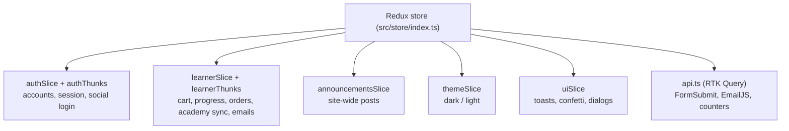

- Saving to storage runs from one `store.subscribe` listener.
- The older hooks (`useStore`, `useAuth`, `useAnnouncements`, `useThemeMode`) are thin wrappers over Redux, so pages did not need rewriting.

---

## 🗺️ JSON-Driven Routing

All routes live in [`src/data/routes.json`](src/data/routes.json). [`src/App.tsx`](src/App.tsx) finds each page with `import.meta.glob` and loads it lazily.

```json
{
  "public":    [{ "path": "/", "file": "./pages/Landing.tsx" }, { "path": "/auth", "file": "./pages/AuthPage.tsx" }],
  "redirects": [{ "path": "/login", "to": "/auth" }, { "path": "/register", "to": "/auth#register" }],
  "protected": [
    { "path": "home", "file": "./pages/Home.tsx" },
    { "path": "courses/:id/grades", "file": "./pages/CourseDetail.tsx", "props": { "tab": "grades" } },
    { "path": "about", "file": "./pages/Info.tsx", "export": "About" }
  ]
}
```

---

## 💾 Storage & Persistence

| Storage | Key | Holds |
| :--- | :--- | :--- |
| localStorage | `tx_users` | Registered accounts (SHA-256 password hashes) |
| localStorage | `tx_session` | Current login |
| localStorage | `tx_user_<email>` | That learner's cart, courses, progress, certificates, preferences |
| localStorage | `tx_theme` | `dark` or `light` |
| localStorage | `tx_lang` | Language for visitors who are not logged in |
| localStorage | `tx_referrals` | Referral codes and rewards |
| localStorage | `tx_announcements` | Posts and replies |
| localStorage | `tx_visits`, `tx_visit_counted` | Visitor counter |
| cookie | `googtrans` | Active live-translation language |
| IndexedDB | `tx_files` | Private files (up to 50 MB) |
| Cache API | `tx-media-v2` | Cached images and videos |

> [!WARNING]
> This is browser storage. For real money and real accounts in production, connect `src/store/api.ts` to your backend or the academy.

---

## 📁 File Management: Every Folder Explained

```text
Takxila-React-new-code-4/
├── README.md                 ← this guide
├── package.json              ← scripts and dependencies
├── package-lock.json         ← exact versions (use npm ci)
├── .env.example              ← copy to .env; public keys only
├── index.html                ← the single HTML page Vite serves
├── vite.config.ts            ← build settings and chunk splitting
├── tsconfig.json             ← strict TypeScript settings
├── docs/
│   └── screenshots/          ← images used in this README
├── tools/                    ← one-off scripts to regenerate course covers and preview videos
├── public/                   ← copied as-is into the build
│   ├── _redirects            ← Netlify: send every route to index.html
│   ├── oauth-callback.html   ← receives Google / Facebook / Microsoft login
│   ├── favicon.png
│   ├── assets/
│   │   ├── covers/           ← 41 course cover images (WebP)
│   │   ├── certificate/      ← template.webp, your certificate background
│   │   ├── email/            ← logo.png used inside emails
│   │   ├── 1.jpg … 8.jpg     ← landing and hero imagery
│   │   └── logo*.{png,svg,webp} ← logo in light and dark variants
│   └── media/videos/         ← 10-second course previews (MP4 + WebM)
└── src/
    ├── main.tsx              ← starts the app, Redux provider, translation guard, idle preloading
    ├── App.tsx               ← builds routes from routes.json
    ├── types.ts              ← shared TypeScript types (Course, Lang, Learner…)
    ├── components/           ← reusable pieces
    │   ├── Layout.tsx        ← top bar, menus, language, cart, profile
    │   ├── CourseCard.tsx    ← course tile used in lists
    │   ├── CoursePromo.tsx   ← black-and-gold special-offer card
    │   ├── NotificationBell.tsx, SearchDialog.tsx, QuizDialog.tsx, ChatWidget.tsx
    │   ├── FastField.tsx     ← lag-free text field
    │   └── fx.tsx, Motion.tsx, Background.tsx ← animations and effects
    ├── context/              ← hooks kept for older pages, now backed by Redux
    ├── data/                 ← content and configuration (edit these first)
    │   ├── courses.ts        ← 46 courses: titles, prices, categories, images
    │   ├── courseContent.ts  ← sections and lectures per course
    │   ├── curriculum.ts, content.ts ← generated curriculum and site copy
    │   ├── showcase.ts       ← combo packs and pricing rules
    │   ├── recommend.ts, quiz.ts ← AI calculator logic and questions
    │   ├── i18n.ts, i18n.more.ts ← menu translations (18 languages)
    │   ├── about.tsx         ← About Us content
    │   ├── routes.json       ← pages and URLs
    │   ├── oauth.json        ← social login public IDs and endpoints
    │   ├── academy.json      ← academy URLs and course instances
    │   ├── promos.json       ← promo card text
    │   └── authExtras.json   ← login labels, calendar, visitor counter
    ├── emails/               ← templates.ts (HTML), send.ts (when to send), EmailPreview.tsx
    ├── features/
    │   ├── resume/           ← themes, form, preview, PDF export, ATS score, file reading
    │   └── certificate/      ← render on template, PNG/PDF download, preview
    ├── pages/                ← one file per screen (Home, Courses, CourseDetail, Cart, …)
    │   └── account/          ← Profile, Purchases, Grades, Calendar, Files, Reports, Preferences
    ├── store/                ← Redux: slices, thunks, RTK Query api
    ├── theme/theme.ts        ← colours, fonts, MUI overrides
    └── utils/
        ├── academy.ts        ← academy cart and checkout links
        ├── social.ts         ← social login popups
        ├── siteTranslate.ts  ← whole-site live translation
        ├── razorpay.ts       ← Razorpay checkout
        ├── mail.ts, contact.ts ← email and contact helpers
        ├── media.ts, image.ts ← media cache and image helpers
        ├── files.ts          ← IndexedDB private files
        └── storage.ts        ← localStorage helpers
```

**Rules of thumb**
- Changing **text, prices, courses, links or keys**? Look in `src/data/` or `.env` first.
- Changing **how a screen looks**? `src/pages/` for the screen, `src/components/` for shared parts.
- Changing **what happens when a learner acts** (buy, complete, log in)? `src/store/*Thunks.ts`.
- Adding **images or videos**? Put them in `public/assets/` or `public/media/` and reference them as `/assets/...`.
- `node_modules/` and `dist/` are generated. Never edit or ship them; `npm ci` and `npm run build` recreate them.

---

## ✍️ Common Tasks (How do I…?)

| I want to… | Do this |
| :--- | :--- |
| Change a course price | Edit `price` (and `was`) in `src/data/courses.ts` |
| Add lectures to a course | Add a section in `src/data/courseContent.ts` under the course id |
| Link a course to the academy cart | Set `instance` in `src/data/academy.json` |
| Change a promo card | Edit `src/data/promos.json` |
| Add a page | Create `src/pages/MyPage.tsx`, add `{ "path": "my-page", "file": "./pages/MyPage.tsx" }` to `routes.json` |
| Translate a new menu item | Add the key to `STRINGS` in `i18n.ts` and `MORE_STRINGS` in `i18n.more.ts` |
| Take real payments | Put `rzp_live_…` in `VITE_RAZORPAY_KEY_ID` and rebuild |
| Send real emails | Fill the three `VITE_EMAILJS_*` keys and rebuild |
| Change the certificate design | Replace `public/assets/certificate/template.webp` (same size) |

---

## 🎨 Design System

| Element | Dark mode | Light mode |
| :--- | :--- | :--- |
| Base | Midnight navy (`#0B1636` → `#13215E`) | Alabaster and white |
| Accent | Gold (`#F5B93F`) | Royal indigo (`#4338CA`) |
| Secondary | Electric lavender (`#7C8CFF`) | Soft violet |
| Promo cards | Black with gold `#D9A441` | Same |

Effects in `src/components/fx.tsx` (spotlight, moving borders, meteors, flip words, 3D tilt) are pure CSS and MUI `sx`, with no animation library.

---

## 🚀 Production Build & Deployment

```bash
npm ci && npm run build   # output in dist/
```

Upload `dist/` to any static host. Every route must fall back to `index.html`:

- **Netlify**: done by `public/_redirects`.
- **Vercel**: add `vercel.json` with `{ "rewrites": [{ "source": "/(.*)", "destination": "/index.html" }] }`.
- **Nginx**: `location / { try_files $uri $uri/ /index.html; }`
- **Apache**: `FallbackResource /index.html`

**Before going live**
- [ ] Redirect addresses registered in Google, Facebook and Microsoft
- [ ] `instance` filled for each course in `academy.json`
- [ ] `VITE_RAZORPAY_KEY_ID` set to the live key
- [ ] EmailJS keys and `VITE_SITE_URL` set
- [ ] No secret anywhere in `.env` or `src/`

---

## 🧯 Troubleshooting

| Problem | Fix |
| :--- | :--- |
| `redirect_uri_mismatch` on Google login | Register `https://YOUR-DOMAIN/oauth-callback.html` and the origin (see [Social login](#-social-login-google--facebook--microsoft)) |
| Login popup closes with no login | Allow popups for the site; check the provider app is Live / published |
| Academy cart is empty after Add to cart | The learner must be logged in to academy.takxila.in in the same browser, and the course needs an `instance` |
| Page not translated | The browser must reach `translate.google.com`; ad blockers can block it |
| "Razorpay is not connected yet" | Set `VITE_RAZORPAY_KEY_ID` and rebuild |
| Refreshing a page shows 404 on the host | Add the `index.html` fallback above |

---

<div align="center">
  <sub>Built with ❤️ by the Takxila team • Learn AI. Practice AI. Think in frameworks. Become AI-ready.</sub>
</div>
